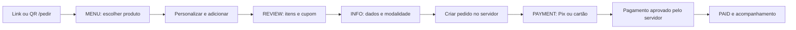
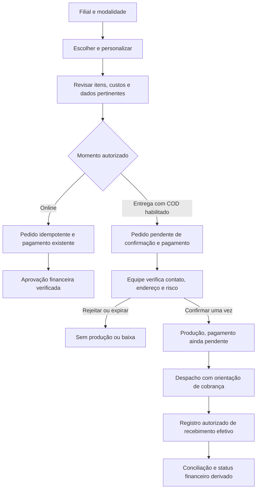

# Cardápio e checkout público — diagnóstico e proposta da issue #221

Data: 25/10/2026. Base local: `a69253bc8af1938749671f4209b127ce07624413`,
branch `cez/51430302`; `origin/main` local aponta ao mesmo SHA. Não houve fetch,
merge, deploy, consulta de dados operacionais ou alteração de autenticação.
Fonte do escopo: [issue #221](https://github.com/emanuelmaraujo/pdv-marcos-kreps/issues/221).

## Estado desta entrega

Atualizado ao fim da implementação local. O usuário autorizou pagamentos e migrations
locais e aprovou a direção visual do protótipo. Foram implementados o resumo de custos,
a vitrine compacta, o checkout em duas colunas no desktop, a idempotência transacional,
o contrato de pagamento na entrega (COD) **desativado em todas as filiais** e o funil
opcional com consentimento. Veja [Implementação final e validação](#implementação-final-e-validação).
Continuam proibidos serviços reais, dados reais, produção, merge e deploy; a migration
não foi aplicada a nenhum banco existente.

As seções seguintes registram o diagnóstico feito antes da implementação.

O [protótipo navegável](../../evidence/issue-221/proposta.html) usa dados sintéticos,
sem chamadas de rede, sem criar pedidos e sem coletar pagamentos. É ilustrativo:
não representa preço, endereço, foto, horário ou capacidade de uma filial real.
Mantém a paleta bege/marrom/vermelho e propõe composição compacta; não substitui
os tokens CSS do aplicativo nem comprova a fonte de produção.

## Evidências de código e jornada atual

| Área | Evidência no checkout consultado | Implicação |
| --- | --- | --- |
| Entrada | `src/lib/constants/branches.ts`: `/pedir` usa `nb`; `/pedir/[slug]/page.tsx` reutiliza a página principal | Preservar QR e deep links; não reintroduzir seleção obrigatória de filial |
| Menu | `src/app/pedir/page.tsx`: hero, categorias, filtros por tags, cards, personalização e carrinho fixo | Evoluir componentes existentes; não reimplementar recursos já presentes |
| Preços | Prévia em `estimatedTotal`; servidor em `create-public-order` valida produtos, adicionais, cupom, filial e frete | Nenhum total do navegador pode autorizar cobrança |
| Embalagem | `create-public-order`: VIAGEM com flag ativa usa taxa da filial positiva, senão global; cobra por pedido | Não aplicar por engano `calculatePackagingEstimate`, que é do PDV interno e por item |
| Revisão | REVIEW detalha subtotal, embalagem e desconto, mas não tem linha de frete normal | Total pode incluir frete sem explicar sua composição nessa tela |
| Envio | INFO permite mudar modalidade depois de REVIEW; rodapé mostra total e apenas “com embalagem” | Última revisão não apresenta valor separado de embalagem/frete/desconto |
| Cadastro | `validateCustomerIdentity`: telefone obrigatório em ENTREGA, opcional nas outras modalidades; nome/e-mail opcionais | Preservar compra sem cadastro e não obrigar telefone em compras online que hoje o dispensam |
| Entrega | CEP consultado, bairro normalizado e zonas por filial; endereço salvo possui fluxo próprio | CEP/GPS não provam posse do contato nem identidade do destinatário |
| Carrinho | `src/features/cart/useCart.ts`: persistência 24h e vínculo de filial; checkout restaura sessão de pedido | Preservar rascunhos e isolamento de filial; não repetir correções anteriores |
| Upsell | `upsellSuggestions` deriva dos mais pedidos retornados pelo backend | Não foi constatado uso de popularidade inventada nesse bloco |
| Pagamento | Pedido é criado antes de escolher Pix/cartão na tela PAYMENT | Mudança de etapas exige preservar pedido existente e retries |
| Confirmação | `confirm-order` recusa AGUARDANDO_PAGAMENTO não pago | COD precisa de autorização operacional própria, sem fingir aprovação de pagamento |
| Baixa | `mark-payment` deriva pagamento dos itens e pode liberar fila/impressão | Não reutilizar baixa financeira para a simples aceitação de COD |
| Expiração | `expire-pending-public-orders` seleciona AGUARDANDO_PAGAMENTO/PENDING | COD não pode entrar inadvertidamente na expiração de Pix |

### Mapa atual



Caminho usual sem cadastro: abrir produto → adicionar → abrir carrinho → continuar
→ continuar para pagamento → escolher meio. Contagem de campos obrigatórios varia
com modalidade, CEP e endereço salvo; não se atribui uma contagem universal.
O caminho expresso para cliente reconhecido precisa continuar permitindo editar dados.

## Priorização

### P0 — pré-condições para pagamento na entrega

1. **Risco de pedidos duplicados por concorrência, constatado por leitura; não
   reproduzido em banco nesta auditoria.** Em `create-public-order`, lookup da chave,
   RPC de criação e UPDATE de `public_idempotency_key` são operações separadas.
   O erro do UPDATE é não bloqueante. Dois requests podem criar duas linhas antes
   de disputar o índice único. A chave deve fazer parte da transação de criação,
   com comparação de payload e filial e resposta estável para retries. Testar
   concorrência em banco descartável antes de classificar como corrigido.
2. COD precisa separar momento esperado, método esperado e pagamento efetivo;
   nunca marcar PAID ou emitir aprovação online na aceitação da unidade.
3. Confirmação deve ser atômica e idempotente, com uma única liberação de produção
   e impressão. Verificar efeitos dos triggers/RPCs antes de qualquer alteração.
4. Faltam decisões operacionais da unidade para habilitação: meios aceitos,
   limite, troco, verificação de contato, prazo e responsável pela baixa.
   Padrão obrigatório da proposta: COD desativado em todas as filiais.

### P1 — transparência e recuperação

- Apresentar resumo discriminado no último passo antes do envio e na via expressa:
  itens/adicionais, desconto, embalagem, entrega, total e modalidade. Não tratar
  frete ainda não determinado como grátis; indicar “a calcular” até endereço válido.
- Preservar revalidação autoritativa, cupom, idempotência, carrinho, sessão de pedido
  e formulário diante de falhas. Não criar nova cobrança ao navegar para trás.
- Texto de WhatsApp no INFO diz que dados são opcionais mesmo em entrega; adaptar
  a explicação à modalidade mantendo a validação existente.
- Instrumentar funil somente com consentimento apropriado e allowlist de dimensões.
  Não transmitir texto livre, identificadores de clientes, endereço, CEP exato,
  token, URL completa, conteúdo de erros ou chaves de idempotência.

### P2 — composição comercial, condicionada à aprovação

- Compactar hero e identificar unidade/endereço com dados confiáveis; comida deve
  aparecer cedo. Nunca inventar prazo, avaliações, promoção, estoque ou fotografias.
- Preservar categorias/personalização; considerar busca textual se o catálogo justificar.
- Desktop: avaliar carrinho lateral; mobile: CTA acessível sem cobrir campos ou teclado.
- Não mudar todos os tokens, navegação ou SDK de pagamento para obter novo visual.

## Baseline e inventário

| Indicador | Resultado desta auditoria |
| --- | --- |
| Sessões, visitantes, fontes e UTMs | Não medido; sem acesso autorizado a analytics real |
| Produto visto → adição → checkout → pedido → pagamento | Não medido; não há integração de funil encontrada em `src/` ou manifest |
| Conversão e abandono por filial/dispositivo | Não medido; nenhuma taxa estimada ou inventada |
| Pedidos/dia e produto popular | Existe endpoint de estatística pública; valores reais não consultados; não equivale a analytics de visita |
| Cobertura, peso e qualidade das fotos reais | Não medido; catálogo operacional não consultado |
| Catálogo no checkout | Código suporta `image_url`, descrição, preço, tags e fallback; isso não prova que as fotos estejam cadastradas |
| LCP, INP, CLS reais | Não medido; dev local com fixtures não é medição de produção |

## Proposta antes/depois

Aprovação solicitada para a direção, não para habilitar COD ou executar operações remotas.

- **Antes:** hero alto → produtos → revisão → dados/modalidade → criar pedido → escolher pagamento.
- **Proposta incremental:** identificação compacta e modalidade cedo → produtos existentes
  → revisão/dados com resumo completo → envio idempotente → pagamento online existente.
  Validar agrupamento de REVIEW/INFO com usuários antes de remover etapas.
- Desktop: conteúdo e resumo em duas colunas; mobile: uma coluna e resumo junto ao CTA.
  Preços dos exemplos são fixtures e não propostas comerciais.
- Primeira implementação recomendada: transparência do resumo e correção transacional;
  evoluir vitrine e instrumentação em diffs independentes; COD após contratos e testes.



## Contrato proposto para COD (diagnóstico; implementado depois)

- `payment_timing`: ONLINE por padrão, ON_DELIVERY somente para ENTREGA autorizada.
- `expected_payment_method`: CASH, DEBIT_CARD, CREDIT_CARD ou PIX; meio recebido
  continua seguindo o contrato financeiro existente, sem sobrecarregar enums atuais.
- Valor para troco em centavos, opcional apenas em dinheiro e nunca inferior ao total;
  isso registra intenção, não prova recebimento.
- Flag por filial inicialmente falsa; métodos presenciais e limite obrigatórios
  para habilitar. Ausência de configuração deve negar COD no servidor.
- Pedido COD recebido: AGUARDANDO_CONFIRMACAO e PENDING; confirmar mantém PENDING;
  entregue mantém PENDING até registro de recebimento. Não retornar “pagamento aprovado”.
- Reusar autorização existente sem modificar auth; filial e ação precisam ser
  autorizadas no servidor. Se a implementação exigir mudar auth/RBAC, pedir
  autorização específica antes dessa mudança.
- Registrar responsável, momento e transição, sem expor sinais antifraude no público.
  Telefone digitado não é verificação de posse; fallback humano quando necessário.
- Distinguir expiração operacional de COD de expiração de Pix. Não criar integração
  WhatsApp ou login de entregador sem decisão e autorização próprias.

## Plano de verificação e limitações

Fixtures devem cobrir matriz filial × modalidade × custos, erros e retries sem rede
externa. Banco descartável deve provar idempotência concorrente, confirmação única,
negação entre filiais e recebimento efetivo antes de liberar COD.

Não foram consultados sites reais de concorrentes nem Baymard: a restrição de serviços
reais foi mantida. Não se apresenta benchmark atualizado de iFood, McDonald's,
Domino's, Burger King ou Uber Eats como realizado. Comparação e pesquisa de referência
continuam pendentes, assim como teste com usuários e inventário de mídia real.

A matriz completa de Fase 0 inclui aberto/fechado, filiais, CEP, cupom, recusa de cartão,
conexão lenta, teclado e acompanhamento. Capturas de fixtures cobrem apenas os estados
explicitamente relacionados nas evidências locais; não comprovam gateway, impressão,
WhatsApp, autenticação ou ambiente publicado.


## Correções pontuais implementadas localmente

- `CheckoutSummary.tsx`: resumo compartilhado em REVIEW e INFO; linhas explícitas
  de itens/adicionais, embalagem, entrega e cupom; total parcial enquanto o endereço
  não está validado. Não altera a criação do pedido, precificação ou cobrança.
- `page.tsx`: usa o resumo nas duas telas e ajusta o texto de WhatsApp conforme
  a modalidade. Telefone continua obrigatório apenas para entrega.
- `ProgressSteps.tsx`: permite encolhimento dos itens; em mobile mantém o nome da
  etapa atual e as demais etapas acessíveis aos leitores de tela. Marca a atual
  com `aria-current="step"`.
- O repro anterior registrou documento com 496 px nos viewports 360, 390 e 430;
  os de 768/1280/1440 já cabiam. O mesmo repro verifica a correção localmente.

Essas correções foram a primeira etapa. Idempotência, COD, instrumentação e vitrine
vieram depois da aprovação, na seção final.

### Verificações

- PASS: 74 testes existentes de pagamento, acompanhamento, identidade, entrega
  e embalagem (cinco arquivos), executados antes das correções.
- PASS: sete testes novos do resumo, cobrindo VIAGEM com/sem taxa, frete e desconto,
  endereço pendente, região bloqueada e frete grátis por cupom.
- PASS: 81 testes da área no diff com as correções (seis arquivos).
- PASS: typecheck, lint focado e verificação de links da documentação.
- PASS: repro de navegador nas seis larguras; documento cabe no viewport e resumo final discrimina embalagem.
- Comparativos do aplicativo: [antes](../../evidence/issue-221/antes-dados-viagem-360.png),
  [depois](../../evidence/issue-221/depois-dados-viagem-360.png) e
  [resumo final visível](../../evidence/issue-221/depois-resumo-final-360.png).
- [Roteiro reproduzível e limites](../../evidence/issue-221/README.md).

As capturas existentes cobrem MENU, produto, REVIEW e INFO/VIAGEM nas seis larguras;
não cobrem a matriz completa de estados da issue. CEP, cupons e falhas de pagamento
possuem testes de partes do fluxo, mas não foram demonstrados visualmente nesta auditoria.
Teclado físico/virtual, pagamento, acompanhamento completo, banco, impressão e
serviços reais não foram validados. Build de produção e teste com usuários não executados.

Comandos efetivamente executados para as correções:

```bash
npm test -- src/app/pedir/_components src/lib/utils/packaging-fee.test.ts src/lib/utils/delivery.test.ts src/lib/utils/customer-identity.test.ts
npm run typecheck
npx eslint src/app/pedir/page.tsx src/app/pedir/_components/ProgressSteps.tsx src/app/pedir/_components/CheckoutSummary.tsx src/app/pedir/_components/CheckoutSummary.test.tsx docs/evidence/issue-221/*.mjs
npm run docs:check
git diff --check
```

O teste direcionado passou com **81 testes em seis arquivos**. Lint focado não
emitiu erros ou avisos. O verificador de documentação analisou 40 arquivos Markdown
sem links locais quebrados. A primeira instalação omitiu dependências de desenvolvimento;
foi repetida com `npm ci --include=dev --ignore-scripts`, sem alterar lockfile.
Uma tentativa de lint foi interrompida (exit 143), e a execução completa seguinte
passou. Capturas interrompidas durante recompilação foram refeitas com servidor
estável; não contam como validação aprovada.

O roteiro de navegador foi executado com `PLAYWRIGHT_MODULE` apontando ao
`index.mjs` do Playwright disponível no ambiente; `AUDIT_PHASE=after` verifica
largura e presença da embalagem no último resumo. O roteiro original CommonJS
foi convertido para ESM para respeitar o lint; a execução ESM validou as correções.

| Viewport | Largura do documento antes | Depois |
| --- | --- | --- |
| 360 | 496 | 360 |
| 390 | 496 | 390 |
| 430 | 496 | 430 |
| 768 | 768 | 768 |
| 1280 | 1280 | 1280 |
| 1440 | 1440 | 1440 |

Os dados brutos estão nos arquivos `antes-auditoria-local.json` e
`depois-auditoria-local.json` junto às capturas; o critério anterior falhou
explicitamente com “Checkout ultrapassa largura do viewport” antes da correção.

## Implementação final e validação

Após a aprovação da direção visual ("pode prosseguir"):

- **Idempotência:** `create_public_order_transactional` cria o pedido e grava a chave
  na mesma transação, com hash do payload; chave repetida com payload diferente é
  recusada. No navegador, a chave fica em `sessionStorage` (apenas chave e hash, 24h)
  e é reutilizada após falha de rede ou recarga.
- **COD:** contrato descrito em [Delivery](../../product/delivery.md#pagamento-na-entrega-cod).
  Política por filial privada e vazia; `get-public-checkout-config` só oferece COD com
  política habilitada, aprovada e limitada. Confirmação (`review_delivery_order_transactional`)
  exige verificação de contato/endereço e gera os jobs de impressão uma vez; `mark-payment`
  exige confirmação de recebimento; expiração própria de confirmação.
  Helpers SQL anteriores ficaram restritos ao `service_role`.
- **Equipe:** detalhes do pedido mostram meio esperado/troco e pedem as duas confirmações
  (contato antes de liberar; recebimento antes da baixa).
- **Cliente:** escolha “Quando pagar” só aparece em ENTREGA com COD habilitado;
  acompanhamento mostra confirmação e pagamento pendentes até a baixa.
- **Funil:** desligado por padrão; consentimento explícito; schema fechado; retenção de 30 dias.
- **Vitrine/checkout:** cabeçalho compacto com unidade e modalidade, cards com “Montar”,
  resumo lateral no desktop.

### Verificações finais (25/10/2026)

| Verificação | Resultado |
| --- | --- |
| `npm test` | PASS — 283 testes em 34 arquivos |
| `npm run typecheck`, `npm run lint` | PASS, sem erros ou avisos |
| `npm run docs:check`, `npm run supabase:check` | PASS — 82 migrations com versões únicas |
| `npm run build` (env loopback do CI) | PASS |
| `node scripts/test-public-delivery-contract.mjs` | PASS — 81 migrations em PostgreSQL 16 sem rede; regras, troco, limites, filial, confirmação, parcial, baixa e expiração; duas conexões concorrentes geram um pedido, um job e um recebimento |
| `docs/evidence/issue-221/qa-cod.mjs` (build local, serviços simulados) | PASS — ver abaixo |
| `AUDIT_PHASE=after docs/evidence/issue-221/auditoria-local.mjs` | PASS — seis larguras sem overflow, embalagem discriminada |

O QA de navegador (`qa-cod.json`) cobre: COD desligado não exibe a escolha; erro sem
meio esperado; troco menor que o total recusado e o erro some ao corrigir; falha de rede
na criação seguida de retry com a **mesma** chave; redirecionamento para acompanhamento
sem exibir “Pago”; nenhum evento de funil sem consentimento; com consentimento, eventos
sem telefone, endereço ou token; resumo visível acima da barra fixa em 390 px e sem
overflow em 390/1440. Capturas: `qa-cod-dados-*.png`, `qa-cod-rodape-390.png` e
`qa-cod-acompanhamento-*.png`.

### Limitações que permanecem

- (Superado na rodada 2, abaixo.) `npm run test:database` e Edge Functions em runtime
  não tinham sido executados na primeira rodada.
- O QA de navegador usa respostas simuladas; não prova gateway, impressão física,
  WhatsApp, autenticação real nem ambiente publicado.
- (Superado na rodada 2.) Configuração pelo painel.
- Conversão, abandono e fotos reais continuam não medidos; nenhum benchmark externo consultado.

## Rodada 2 — validação integral, painel e revisão independente (26/10/2026)

### Defeitos encontrados e corrigidos

| Severidade | Defeito | Correção |
| --- | --- | --- |
| Alta | A criação COD exigia telefone `55…`, mas `create-public-order` grava `+55…`: **todo pedido COD real seria recusado**. O teste isolado usava o formato errado. | Regra `^\+55…` e fixture em E.164, mais um caso negativo |
| Média | Cancelar um item de pedido COD mantinha `total_amount`, fazendo cobrar o que não foi entregue | Cancelamento de item isolado recusado em `update-order-item-status` e no guard do banco (para chamadas `authenticated`); o pedido inteiro continua cancelável |
| Média | A confirmação COD não enfileirava o WhatsApp `order_received` | Enfileirado após a confirmação, sem reenviar em retry |
| Baixa | A via do cliente mostrava `CASH`, `PENDING` e “Forma: PIX” em pedido COD | Texto em pt-BR, com valor a cobrar, forma combinada e troco |
| Baixa | IFOOD/CORTESIA eram oferecidos e aceitos na troca de meio em COD | Filtrados na tela e recusados em `change-payment-method` |
| Baixa | O acompanhamento mostrava “pendente” em COD cancelado ou expirado | Mostra “Pedido encerrado sem cobrança” e “estornado” |
| Baixa | Não era possível rejeitar entre o fim do prazo e a varredura | REJECT permitido após o prazo; CONFIRM continua bloqueado |
| Baixa | Erro de troco virava “COD indisponível” | Mensagem específica de troco |
| Baixa | `cod_action` era ignorado em pedido online | Recusado |
| Baixa | O cliente podia ocupar o id determinístico de um evento SERVER do funil | Id do evento CLIENT derivado no servidor (`sha256("client:"+id)`) |
| Baixa | Uma falha na expiração COD interrompia a expiração online | Registrada em log; a online continua |
| Baixa | Funil registrava PIX ao escolher “Online”; falha de rede virava `ORDER` | Sem evento falso; categoria `NETWORK` |
| Baixa | 68 capturas (5,4 MB) versionadas | Subconjunto curado (1,2 MB) |

O fixture isolado passou a usar a extensão `.psql`: o runner do `supabase test db` também
executava o arquivo sozinho, fora da transação do teste.

### Configuração por filial no painel

Cartão “Pagamento na entrega” na aba Entrega da filial, salvo por `set_branch_cod_policy`
(`can_manage_branch`, validação no servidor, aprovação com data e responsável carimbados,
auditoria `COD_POLICY_UPDATED`). A tabela continua fora do PostgREST e os limites não vão
ao checkout. Detalhes em [Delivery](../../product/delivery.md#pagamento-na-entrega-cod).

### Revisão independente

A revisão (subagente sem o contexto da implementação) apontou 2 problemas médios e 10 baixos,
nenhum alto. Ela confirmou `search_path` e grants das funções SECURITY DEFINER, que o ator
vem do JWT, a idempotência e a impressão única, que o COD nunca vira PAID sem baixa e que a
janela de deploy (migration antes das funções novas) é compatível com as funções antigas.
Todos os achados da tabela acima foram atendidos, exceto os mantidos como decisão:

- `PayItemsModal` passou a somar `delivery_fee` também no online. Isso alinha a tela com a
  RPC, que já cobrava a taxa na última parcela.
- A evolução da vitrine (miniatura, cabeçalho) faz parte do redesign aprovado.
- `cod_expires_at` não é protegido contra UPDATE direto por ADMIN da filial. Estender o
  prazo não paga nem libera produção, e confirmar continua exigindo a RPC.

### Verificações desta rodada

| Verificação | Resultado |
| --- | --- |
| `npm run check` | PASS — 295 testes em 37 arquivos, tipos, lint, docs, config Supabase (82 migrations) |
| `npm run build` (env loopback do CI) | PASS |
| `npm run test:database` (Supabase completo, Docker) | PASS — 7 arquivos pgTAP, incluindo a política pelo painel |
| `npm run test:cod-e2e -- --admin-qa` | PASS — 40 verificações E2E nas Edge Functions locais; painel com login real em 390 e 1440 px |

O E2E passa pelas Edge Functions reais (edge-runtime local) com usuários sintéticos e cobre:
- política pelo painel e checkout;
- três envios simultâneos com a mesma chave;
- confirmação por outra filial, confirmação sem contato e retry;
- vias CUSTOMER e KITCHEN uma única vez, via em pt-BR e WhatsApp na fila;
- cancelamento de item recusado, despacho e entrega pelo motoboy;
- baixa sem confirmação, com valor errado e duplicada;
- caixa com R$ 45,00 em dinheiro;
- rejeição, expiração e funil (PII, consentimento e evento financeiro forjado).

### Limitações reais

- Tudo roda em instância descartável com dados sintéticos. Não houve aplicação da
  migration em produção, impressão física, envio de WhatsApp nem pagamento real.
- O CI executa `test:database`, mas não o E2E nem o QA do painel (exigem edge-runtime e Playwright).
- A conciliação usa o `cash-report`, que já ignorava estornos antes desta mudança.
- Nenhum teste com operadores ou clientes reais. O piloto continua como passo operacional.
- (Resolvido na rodada 3.) Cancelamento de COD com valor recebido.
- A segunda rodada da revisão independente aprovou (`approve`). Os dois pontos baixos que
  ela levantou foram atendidos: `NULLIF` no guard e texto de cancelamento após recebimento.
- (Resolvido na rodada 3.) 403 em `delivery_zones`.

## Rodada 3 — pendências antes do merge (26/10/2026)

- **Cancelamento COD com valor recebido:** o guard em `orders` recusa a passagem para
  CANCELADO/EXPIRADO quando `cod_received_amount > 0`. Isso vale para o backend, para a API
  direta e para o recálculo derivado dos itens (o statement inteiro é desfeito) e serializa
  com o recebimento pelo lock da linha. `update-order-status` antecipa a mensagem.
  Depois do estorno (ADMIN, `mark-payment REFUNDED`), o cancelamento é aceito, e
  `payments` e `audit_logs` ficam intactos. Não há tela de estorno; isso está documentado.
- **403 em `delivery_zones`:**
  - **Causa:** a migration `20260909040313` concedeu `SELECT` explícito às tabelas da equipe
    e omitiu `delivery_zones`. Num banco recriado só por migrations, o ACL ficava
    `authenticated=Dxtm`.
  - **Correção:** `GRANT SELECT, INSERT, UPDATE, DELETE` ao `authenticated`. As policies
    existentes limitam a leitura à filial e a escrita ao ADMIN da filial.
  - **Produção:** provavelmente já tem esse acesso pelos grants do Dashboard; não foi
    possível confirmar, porque a leitura do banco não foi autorizada nesta sessão.
- **Migrations pendentes:** só `20261025212158_public_delivery_payment_contract.sql`. O log do
  deploy de `a69253b` registrou “Remote database is up to date” e a `main` não avançou desde então.
- **Revisão independente:** o código foi aprovado. O rollback inicial (revert do merge
  inteiro) quebraria o deploy, porque apagaria a migration aplicada; a correção também foi aprovada.

| Verificação | Resultado |
| --- | --- |
| `npm run check` | PASS — 295 testes, tipos, lint, docs, Supabase |
| `npm run build` | PASS |
| `test:database` | PASS — 89 testes pgTAP em 8 arquivos (novo: `delivery_zones_access`) |
| `test:cod-e2e -- --admin-qa` | PASS — 46 verificações (corrida cancelar × receber, API direta, estorno → cancelamento) e painel com a listagem de bairros sem 403 |

