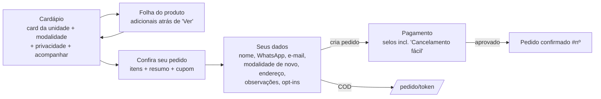

# #235 — Fase 0: auditoria e proposta visual do cardápio e checkout público

Data: 29/10/2026. Branch `cez/26179825` (PR #239, rascunho). **Proposta para aprovação, não
implementação.** Nada aqui foi publicado; as telas `proposta-*` são de um HTML estático
ilustrativo. A implementação ampla (Fases 1–3) só começa após a decisão do operador sobre a
seção [Decisões para aprovação](#decisões-para-aprovação).

Evidências: [`docs/evidence/issue-235/fase0/`](../../evidence/issue-235/fase0/) —
`publicado-*` (site real, só leitura), `atual-*` (código atual com catálogo sintético),
`proposta-*` (protótipo) e os roteiros de captura.

## 1. Código × publicado

| Item | Código (`origin/main` 2fe6c2c + PR #239) | Publicado (www.marcoskreps.com.br, 29/10 ~19:47 UTC) |
| --- | --- | --- |
| Resumo discriminado, embalagem, “Quando pagar” (PR #234) | presente | presente no bundle JS publicado |
| Ordem dos dados | Nome → WhatsApp (PR #239) | WhatsApp → Nome (PR #239 não publicado — esperado) |
| `/pedir` (filial padrão) | — | Núcleo Bandeirante: “Pedidos pausados pelo administrador” |
| `/pedir/filiais` | — | 1 unidade listada: “Feira · 17:00–22:00” |
| Cardápio de uma filial aberta | capturado localmente | **BLOCKED**: Vercel Security Checkpoint (Code 21) rejeita Chromium headless; o desafio não foi contornado |

Diferença de configuração entre filiais: a filial aberta por padrão em `/pedir` não aparece no
hub de filiais, e o cliente que chega pelo link principal cai em “pausado” sem ver o cardápio.
Isso é configuração/operação, não código — **requer confirmação do operador** (é intencional?).
A versão exata publicada não foi identificada (sem build id exposto); só a presença dos textos.

Para capturar o cardápio publicado faltam: um navegador humano no horário de funcionamento ou
um bypass de proteção da Vercel autorizado pelo responsável (não solicitado).

## 2. Jornada atual capturada (código, fixtures)

`capturar-atual.mjs`: cardápio → personalização → revisão → dados em 360/390/430/768/1440 px,
sem overflow horizontal nem erros de página. Pagamento, Pix/cartão e confirmação exigem criar
um pedido e **não foram capturados** (SKIP: fora do que é seguro simular nesta fase; avaliados
pelo código). Teclado virtual: BLOCKED no headless.

| Largura | Topo do 1º produto | Altura da tela |
| --- | --- | --- |
| 360 | 695 px | 844 |
| 390 | 679 px | 844 |
| 430 | 627 px | 844 |
| 768 / 1440 | 575 px | 844 / 900 |

No celular, o primeiro produto começa a ~80% da primeira dobra
([atual-menu-dobra-390](../../evidence/issue-235/fase0/atual-menu-dobra-390.png)).

## 3. Diagnóstico priorizado

P0 = confiança/dado incorreto; P1 = conversão/clareza/acessibilidade; P2 = acabamento.

| # | Pri. | Achado | Onde | Proposta |
| --- | --- | --- | --- | --- |
| 1 | P0 | Selo “Cancelamento fácil” no pagamento sem nenhum fluxo de cancelamento pelo cliente (não existe função/rota para isso) | `src/app/pedir/page.tsx:2672` | Remover. Manter só fatos: processado pelo Mercado Pago; preparo após aprovação |
| 2 | P1 | “Pedido confirmado” após pagamento aprovado mistura pagamento e aceite da unidade | `page.tsx:2814` | “Pagamento aprovado” + status real do pedido; COD segue em `/pedido/[token]` com “aguardando a unidade” |
| 3 | P1 | Nome do cliente não aparece na confirmação; número do pedido é o título | `page.tsx:2777-2817` | “Obrigado, {nome}!” em destaque; nº do pedido secundário e copiável (gerado pelo sistema) |
| 4 | P1 | Primeira dobra consumida por card da unidade, botões de modalidade em 2 linhas, “Privacidade” e “Já fez um pedido?” antes da comida | `page.tsx:1761-1792` | Cabeçalho compacto (marca, unidade, status, Trocar, ícone Acompanhar) + modalidade em 1 linha; privacidade no rodapé |
| 5 | P1 | Modalidade escolhida duas vezes (vitrine e dados) | `page.tsx:1771`, `:2355` | Escolha única na vitrine; nos dados vira resumo “Para levar · Feira [Alterar]” |
| 6 | P1 | CTA “Montar” igual para kreps e bebidas; botões vermelhos grandes em todo card competem com o preço | `page.tsx:1942` | Botão “+” 44 px na foto (`aria-label="Adicionar {produto}"`); vermelho reservado ao CTA principal |
| 7 | P1 | Fallback sem foto usa ícone de chama (sugere “picante”) e a folha do produto abre com faixa escura de ~300 px sem informação | `page.tsx:1912`, `:2957` | Fallback desenhado (ilustração de krep + “Salgado/Doce”), hero de 150 px |
| 8 | P1 | Adicionais escondidos atrás de “Ver” em caixa tracejada com copy de marketing (“Quer deixar ainda melhor?”, “turbinar”) | `page.tsx:3047-3064` | Lista visível com todos os adicionais vinculados ao produto, preço “+ R$ 4,00” e contador sem teto; total atualizado no botão |
| 9 | P1 | Toast “adicionado ao pedido” cobre o título da revisão; título em card escuro gasta espaço | `page.tsx:2062`, captura `atual-revisao-390` | Toast curto acima da barra da sacola; título simples na barra |
| 10 | P2 | Nome do item espremido entre preço e dois ícones na revisão (“Krep / Calabresa”) | captura `atual-revisao-390` | Linha: nome + modificadores à esquerda; preço e contador à direita; “Editar” como link |
| 11 | P2 | Textos sem acento: “Cardapio” no cabeçalho; “Cartao de credito, debito” | `page.tsx:1674`, `_components/MercadoPagoBrick.tsx:158` | Corrigir (pode entrar já na Fase 1) |
| 12 | P2 | Placeholder do cupom em caixa alta e botão “Aplicar” cinza dominante | captura `atual-revisao-390` | “Tenho um cupom” recolhido |
| 13 | P2 | Preço em vermelho com “R$” pequeno de baixo contraste | `page.tsx` cards | Preço em `--text-primary`, peso 700, `tabular-nums` |
| 14 | P2 | Sidebar do carrinho no desktop começa abaixo das abas e diz “Escolha um krep para montar” | `page.tsx:1972`, `atual-menu-1440` | Sacola fixa no topo direito, com itens, resumo e CTA |

Já resolvidos e a preservar: resumo discriminado antes do envio (PR #234), duas colunas no
desktop, ausência de overflow e ordem Nome → WhatsApp com lookup que não sobrescreve nome
(PR #239).

## 4. Princípios de referência

Comparação por princípios, sem copiar telas/marcas de iFood, Domino's, McDonald's ou Uber Eats.
Os artigos de Baymard e NN/g citados na issue **não foram relidos nesta rodada**; os princípios
abaixo são o consenso amplamente publicado e devem ser conferidos antes da decisão final:

- Comida e preço visíveis na primeira tela; contexto (unidade, horário, modalidade) compacto.
- Ação de adicionar previsível e próxima do item; personalização com custo explícito.
- Custos totais conhecidos antes do compromisso; sem surpresas no último passo.
- Formulário curto, rótulos persistentes, campos opcionais marcados, pedir só o necessário,
  `autocomplete` correto, erros ligados ao campo.
- Mensagens de confiança só com fatos verificáveis.

## 5. Mapa do fluxo

Antes (código atual):



Depois (proposta):

```mermaid
flowchart LR
  A[Vitrine<br/>cabeçalho compacto + modalidade única] --> B[Personalização<br/>adicionais visíveis com preço]
  B --> A
  A --> C[1 Sacola<br/>itens editáveis + resumo<br/>modalidade como resumo]
  C --> D[2 Seus dados<br/>Nome → WhatsApp → e-mail recolhido<br/>endereço só em ENTREGA<br/>observações/opt-ins]
  D -->|cria pedido| E[3 Pagamento<br/>Pix ou cartão; só fatos]
  D -->|COD| G[/pedido/token/<br/>aguardando a unidade]
  E -->|aprovado| F[Obrigado, nome!<br/>Pagamento aprovado · nº copiável]
```

Mesmo número de etapas que criam/cobram o pedido; o pedido continua sendo criado só ao sair
de “Seus dados”. A barra de progresso passa de 5 para 3 passos visíveis (Sacola, Dados,
Pagamento). Toques estimados no percurso balcão sem login (1 krep sem personalizar, Pix),
contados nas telas: atual ≈ 6 (Montar, Adicionar, Ver pedido, Continuar, Continuar para
pagamento, gerar Pix) → proposta ≈ 5 (+, Ver sacola, Continuar, Continuar para pagamento,
Gerar Pix), **se** o “+” adicionar direto (decisão 7). Estimativa por inspeção, **não medição
com usuários**.

## 6. Mini design system proposto

Mantém a identidade pública existente (`[data-context="public"]` em `src/app/globals.css`):
vermelho `#E73335`, bege `#FAF5EE`/`#F3EDE4`, marrom `#1E1008`, Plus Jakarta Sans. Acréscimos:

| Token | Valor | Uso |
| --- | --- | --- |
| Raio | 10 / 14 / 20 / 999 px | campos, cards, folhas, pílulas |
| Espaço | 4 · 8 · 12 · 16 · 24 · 32 | grid de 4 px; margem lateral 16 px no mobile |
| Alvo de toque | 44 px | todos os controles, incluindo “+” e contadores |
| Tipografia | 20/700 título · 17/700 seção · 15/700 item · 14/400 corpo · 12 legenda | `tabular-nums` em preços |
| Vermelho | só CTA principal, “+” e indicador de etapa | preço passa a `--text-primary` |
| Marrom inverso | modalidade e aba ativas, checkbox marcado | |
| Sombras | `--shadow-sm/md/lg` quentes existentes | flutuantes (“+”, barra da sacola) usam `md` |
| Movimento | 150–200 ms, `ease-out`; desligado em `prefers-reduced-motion` | folha, toast, contador |

Sem selos, depoimentos, “mais pedidos”, avaliações, prazos ou descontos inventados. Fotos reais
quando houver `image_url`; quando não houver, ilustração vetorial do krep no cone com luva de
papel nas cores da marca (versões salgada e doce), sobre fundo bege radial. É uma ilustração,
não uma foto: não representa um produto específico.

## 7. Telas propostas

Mobile 390 px: [vitrine](../../evidence/issue-235/fase0/proposta-vitrine-390.png) ·
[personalização](../../evidence/issue-235/fase0/proposta-produto-390.png) ·
[sacola](../../evidence/issue-235/fase0/proposta-sacola-390.png) ·
[dados/entrega](../../evidence/issue-235/fase0/proposta-dados-entrega-390.png) ·
[pagamento](../../evidence/issue-235/fase0/proposta-pagamento-390.png) ·
[confirmação](../../evidence/issue-235/fase0/proposta-confirmacao-390.png).
Desktop 1440 px: [vitrine + sacola](../../evidence/issue-235/fase0/proposta-vitrine-1440.png) ·
[dados + resumo](../../evidence/issue-235/fase0/proposta-dados-1440.png).
Fonte: [proposta.html](../../evidence/issue-235/fase0/proposta.html).

Comparação direta: atual [cardápio 390](../../evidence/issue-235/fase0/atual-menu-390.png),
[produto](../../evidence/issue-235/fase0/atual-produto-390.png),
[revisão](../../evidence/issue-235/fase0/atual-revisao-390.png),
[dados](../../evidence/issue-235/fase0/atual-dados-390.png),
[cardápio 1440](../../evidence/issue-235/fase0/atual-menu-1440.png).

Ajustes pedidos pelo operador nesta rodada (29/10):

- **Adicionais sem limite**: a personalização mostra todos os adicionais vinculados ao produto
  e o contador não tem teto. O código atual já funciona assim (`page.tsx`, contador de
  adicionais sem máximo; `create-public-order` não limita quantidade); o “até 2 de cada” e as
  duas opções eram só do protótipo. Quais adicionais aparecem em cada krep depende do cadastro
  do cardápio.
- **WhatsApp sem avisos de obrigatoriedade**: o campo mostra só “WhatsApp com DDD”, sem
  “(obrigatório)/(opcional)” nem texto de ajuda. Já aplicado no código (PR #239). Em ENTREGA,
  continuar sem número válido ainda mostra o erro acima do botão e não cria o pedido.
- **Ilustração do krep** redesenhada (cone com luva de papel), no lugar do triângulo simples.

Os textos de status da confirmação são exemplos; na implementação vêm dos status reais
(`order-tracking-helpers.ts`). Valores e horários vêm sempre do servidor e da filial.

## Decisões para aprovação

1. **Direção visual** das telas `proposta-*` (lista com foto à direita e “+”, cabeçalho compacto,
   preço em preto, vermelho só no CTA). Aprovar, ajustar ou rejeitar.
2. **Remover “Cancelamento fácil”** já (achado P0), mesmo antes do redesign.
3. **Modalidade única** na vitrine, com resumo “Alterar” nos dados.
4. **E-mail recolhido** (“Adicionar e-mail”) — continua opcional; o Mercado Pago pode pedir
   e-mail no próprio formulário de cartão.
5. **Progresso em 3 passos** (Sacola, Dados, Pagamento) em vez de 5.
6. **Hub de filiais**: a filial padrão de `/pedir` (Núcleo Bandeirante, pausada) fora da lista
   é intencional? (Configuração, fora do código.)
7. **“+” adiciona direto** produtos sem adicionais obrigatórios (tocar no card abre a
   personalização); com adicionais obrigatórios, o “+” abre a folha.

## Plano após aprovação (sem backend/migrations)

1. Correções de confiança e copy (#1, #2, #11) — pequeno, isolado.
2. Vitrine: cabeçalho, modalidade, cards, fallback, barra da sacola (Fase 1).
3. Personalização e sacola (Fase 1).
4. Dados e confirmação: modalidade como resumo, e-mail recolhido, nome na confirmação (Fase 2).
5. QA (Fase 3): Playwright com fixtures em 360/390/430/768/1440, teclado, foco, contraste,
   estados (vazio, sem foto, encerrado, CEP fora, erro de criação, Pix expirado), percursos
   balcão/entrega/perfil salvo; LCP/INP/CLS onde houver medição.

Não muda: cálculo de total, taxas, `payment_timing`, idempotência, criação de pedido, tokens de
acompanhamento, Edge Functions, RLS e pagamentos.

## Limitações

- Cardápio publicado não capturado (checkpoint da Vercel); versão publicada inferida pelos textos.
- Fonte das capturas é o substituto local, não a Plus Jakarta Sans web.
- Sem pagamento, Pix, cartão ou confirmação reais capturados; sem teste com compradores.
- Toques e decisões são estimativas por inspeção; nenhuma métrica de conversão foi medida.
